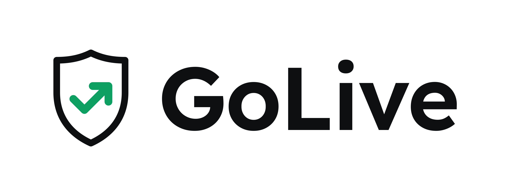

<p align="center">
  <picture>
    <source media="(prefers-color-scheme: dark)" srcset="docs/assets/logo-dark.png">
    
  </picture>
</p>

<p align="center">
  <strong>Le feu vert open source avant toute mise en production.</strong><br>
  Décrivez votre projet. PcyBox GoLive vérifie tout et délivre un feu vert vérifiable, ou la liste exacte de ce qui bloque.
</p>

<p align="center"><a href="README.md">English version</a></p>

---

Chaque jour, des sites, applications et API partent en production sans pages légales, sans sécurité de base, sans sauvegarde, sans supervision ni conformité aux lois sur les données. Les référentiels existent (OWASP, RGPD, WCAG, lois nationales) mais ils sont éparpillés, longs et rarement adaptés au projet réel.

PcyBox GoLive les transforme en **règles versionnées et déterministes**, confrontées à ce que vous **déclarez** (votre architecture), ce que vous **codez** et ce qui est **en ligne**. Un seul verdict : **Go**, **Go conditionnel** ou **No-Go**.

## L'édition Community

- **Studio** : dessinez votre architecture (composants, technologies, flux, pays d'hébergement). Les problèmes s'affichent sur le schéma pendant que vous dessinez.
- **GoLive Spec** : tout est enregistré dans un `golive.yaml` versionné avec votre code, synchronisé dans les deux sens avec le Studio.
- **Moteur déterministe** : même `golive.yaml`, mêmes versions de packs, même état du site, même verdict, avec une empreinte reproductible. Aucune IA ne décide.
- **Packs de conformité** : Socle, Sécurité web (OWASP), Exploitation, Accessibilité (WCAG 2.2), Paiement, Sénégal (CDP), Union européenne et France (RGPD). Chaque règle cite sa source.
- **Audit du site en ligne** : saisissez une URL, l'audit tourne en tâche de fond. *Rapide* : contrôles passifs de la page d'accueil (TLS, en-têtes, cookies, pages légales, indexation). *Complet* : un vrai Chromium parcourt jusqu'à 20 pages comme un visiteur et vérifie l'accessibilité avec axe-core (WCAG 2.2 AA), les liens cassés, les Core Web Vitals, le contenu mixte et les traceurs chargés avant consentement. Protégé contre le SSRF, après preuve de propriété du domaine (DNS ou fichier).
- **Équipes** : comptes, organisations, rôles (propriétaire, administrateur, membre, invité) et rôles par projet (responsable, éditeur, contributeur, valideur, lecteur). Invitations par e-mail valables 7 jours, date de fin d'accès, journal d'activité inaltérable. Cloisonnement garanti par le Row Level Security de PostgreSQL.
- **Preuves et dérogations** : ce qu'un robot ne peut pas vérifier (test de restauration, déclaration CDP, contrats de sous-traitance…) est attesté par une personne nommée. Une dérogation signée transforme un bloquant en Go conditionnel jusqu'à son échéance.
- **Kanban de remédiation** : une tâche par écart, sans doublon, fermée automatiquement quand l'audit constate la correction, rouverte en cas de régression.
- **Rapport** Go / No-Go imprimable (PDF) et export JSON.
- **Analyse du dépôt** : secrets versionnés, dépendances vulnérables (base OSV), Dockerfile en root, bases publiées par compose. Utilise aussi Gitleaks s'il est installé.
- **CLI** `golive check --repo .` pour la CI, qui sort en erreur sur un No-Go.

## Démarrer

```bash
cp .env.example .env
# renseignez BETTER_AUTH_SECRET, par exemple avec : openssl rand -base64 32
docker compose up --build
# puis http://localhost:3000 et créez le premier compte
```

Depuis les sources (Node.js 22+, pnpm 11+, PostgreSQL 15+) :

```bash
pnpm install
cp .env.example .env        # DATABASE_URL vers votre base PostgreSQL
pnpm db:migrate
pnpm dev                    # application web et worker d'audit
```

En ligne de commande :

```bash
pnpm --filter @golive/cli build
node apps/cli/dist/golive.js init --template public-service
node apps/cli/dist/golive.js check --repo . --url https://preprod.exemple.sn --env preprod
```

## Avertissement

Le rapport PcyBox GoLive atteste d'un contrôle à une date donnée. Il ne constitue ni une garantie de sécurité ni un avis juridique. Les packs légaux (Sénégal, UE) sont communautaires et en attente de revue par des juristes partenaires : leurs exigences sont à valider par un juriste.

## Licences

Serveur, application web, moteur et sonde : AGPL-3.0. Format GoLive Spec, SDK de règles, packs communautaires et CLI : Apache-2.0. Voir [README.md](README.md#license).
