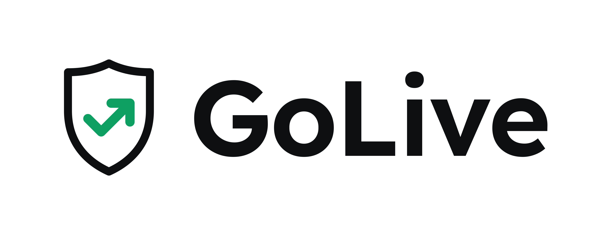

<p align="center">
  <picture>
    <source media="(prefers-color-scheme: dark)" srcset="docs/assets/logo-dark.png">
    
  </picture>
</p>

<p align="center">
  <strong>The open-source go / no-go gate before any production launch.</strong><br>
  Describe your project. PcyBox GoLive checks everything and returns a verifiable green light, or the exact list of what blocks it.
</p>

<p align="center">
  <a href="README.fr.md">Version française</a> ·
  <a href="docs/spec.md">GoLive Spec</a> ·
  <a href="docs/writing-rules.md">Write a rule</a> ·
  <a href="CONTRIBUTING.md">Contribute</a>
</p>

---

Websites, apps and APIs go live every day without legal pages, basic security, backups, monitoring or data-protection compliance. The checklists exist (OWASP, GDPR, WCAG, national laws) but they are scattered, long and rarely fit the actual project.

PcyBox GoLive turns them into **versioned, deterministic rules** that run against what you **declare** (your architecture), what you **code** and what is **online**, and returns one verdict: **Go**, **Conditional Go** or **No-Go**.

## What you get in Community

| | |
| --- | --- |
| **Studio** | Draw your architecture on a canvas: components, technologies, data flows, hosting countries. Problems appear on the diagram as you draw. |
| **GoLive Spec** | Everything is saved in a plain `golive.yaml` you version with your code. The Studio and the file stay in sync both ways. |
| **Deterministic engine** | Same `golive.yaml` + same pack versions + same site state = same verdict, with a reproducible fingerprint. No AI decides. |
| **Compliance packs** | Core, Web security (OWASP), Operations, Accessibility (WCAG 2.2), Payment, Senegal (CDP), EU and France (GDPR). Every rule cites its source. |
| **Live site audit** | Enter a URL and get a real audit in the background. *Quick*: passive checks of the home page (TLS, security headers, cookies, legal pages, indexing). *Full*: a real Chromium browses up to 20 pages like a visitor and checks accessibility with axe-core (WCAG 2.2 AA), broken links, Core Web Vitals, mixed content and trackers loaded before consent. SSRF-safe, domain ownership proven by DNS or file first. |
| **Teams** | Accounts, organizations, roles (owner, admin, member, guest) and per-project roles (manager, editor, contributor, validator, reader). Invitations by e-mail valid 7 days, optional access end date, append-only activity log. Tenant isolation enforced by PostgreSQL row level security. |
| **Proofs and waivers** | What a robot cannot verify (restore test, CDP filing, DPA…) is attested by a named person. A signed waiver turns a blocker into a Conditional Go until it expires. |
| **Remediation board** | One task per open issue, no duplicates, closed automatically when the audit sees the fix, reopened on regression. |
| **Report** | Printable Go / No-Go report (PDF) and JSON export. |
| **Repository scan** | Committed secrets, vulnerable dependencies (OSV database, npm, PyPI, Go, Packagist, RubyGems, crates.io), Dockerfiles running as root, datastores published by compose. Uses Gitleaks too when installed. |
| **CLI** | `golive check --repo .` in your CI. Exits non-zero on No-Go. |

## Quick start

### Self-hosted

```bash
cp .env.example .env
# set BETTER_AUTH_SECRET in .env, for example with: openssl rand -base64 32
docker compose up --build
# open http://localhost:3000 and create the first account
```

The stack is PostgreSQL, the web app and the audit worker (official Playwright image). No external account or SaaS dependency. Without `SMTP_URL`, invitation links are shown in the interface so you can pass them on yourself.

### From source

```bash
pnpm install
cp .env.example .env        # point DATABASE_URL to a PostgreSQL 15+ database
pnpm db:migrate
pnpm dev                    # web app on http://localhost:3000 and the audit worker
pnpm test                   # set DATABASE_URL_TEST to also run the row level security tests
```

Requires Node.js 22+ and pnpm 11+. Locally the robot uses the bundled Chromium if present, otherwise your installed Chrome or Edge.

### CLI

```bash
pnpm --filter @golive/cli build
node apps/cli/dist/golive.js init --template ecommerce
node apps/cli/dist/golive.js check                      # layer 1 (architecture)
node apps/cli/dist/golive.js check --repo .             # + layer 2 (secrets, dependencies, containers)
node apps/cli/dist/golive.js check --url https://example.com --env preprod
node apps/cli/dist/golive.js check --format markdown    # for a PR comment
node apps/cli/dist/golive.js rules                      # browse the catalogue
```

Exit codes: `0` Go, `1` No-Go (or Conditional with `--fail-on conditional`), `2` invalid spec.

## A `golive.yaml`

```yaml
spec: golive/v1
project:
  name: Citizen e-services
  type: public-service
  countries: [ SN ]
  criticality: public-service
data:
  personal: [ identity, contact ]
  sensitive: [ national-id ]
features: [ accounts, admin, uploads ]
components:
  - id: web
    kind: frontend
    tech: nextjs@16
  - id: api
    kind: backend
    tech: nestjs@11
    runtime: nodejs@22
  - id: db
    kind: database
    tech: postgresql@17
    hosting: { provider: senum, country: SN }
links:
  - { from: web, to: api, protocol: https }
  - { from: api, to: db, protocol: postgres-tls, sensitivity: sensitive }
targets:
  preprod: https://preprod.example.sn
evidence:
  sn.cdp.declaration: { by: "A. Diop, DPO", date: 2026-11-02, url: https://intranet/cdp-receipt }
```

Full reference: [docs/spec.md](docs/spec.md).

## How the verdict is computed

1. Packs are selected from the project (type, features, countries) or listed explicitly in `profiles`.
2. Each rule returns `pass`, `warn`, `fail`, `evidence` (proof required), `na` or `not-run`.
3. Score per category and overall, weighted by severity (blocker 10, major 5, minor 2, info 1).
4. **No-Go** if any blocker is open, or the score is under the threshold (70, or 80 for financial, health and public services). **Conditional Go** if every open blocker is covered by a valid waiver. Otherwise **Go**.

`--repo` reads files only and never runs project code. Secret values are never stored, only their location. Dependency versions are sent to [osv.dev](https://osv.dev) to look up known vulnerabilities; use `--offline` to skip that step.

The verdict never depends on an AI. Legal findings always carry a "to be validated by a lawyer" notice: PcyBox GoLive flags, cites and points, it does not give legal advice.

## Repository layout

```
apps/
  web/            Next.js app and API: Studio, checks, board, report, teams (AGPL-3.0)
  worker/         Audit worker: runs queued audits, applies migrations (AGPL-3.0)
  cli/            golive command line (Apache-2.0)
packages/
  spec/           GoLive Spec schema, parser, catalogue, templates (Apache-2.0)
  packs-sdk/      Rule and pack SDK (Apache-2.0)
  engine/         Deterministic evaluation, score, verdict, task reconciliation (AGPL-3.0)
  probe/          Passive, SSRF-safe web observation (AGPL-3.0)
  robot/          Multi-page browser audit: axe-core, vitals, links, trackers (AGPL-3.0)
  scanner/        Repository scan: secrets, dependencies, containers (AGPL-3.0)
  db/             PostgreSQL schema, row level security, job queue (AGPL-3.0)
packs/            Community compliance packs (Apache-2.0)
```

## Editions

| | Community | Premium | Gov & Sovereign |
| --- | --- | --- | --- |
| Studio, engine, packs, CLI | ✓ | ✓ | ✓ |
| Self-hosted | ✓ | | ✓ |
| AI copilot (architecture from a brief) | | ✓ | ✓ (self-hosted model possible) |
| Signed report, public badge, registry | | ✓ | ✓ |
| Scheduled audits, alerts, team features | | ✓ | ✓ |
| National dashboard, official national pack | | | ✓ |

Rule of thumb: everything needed to **verify** stays open; what saves a **team** time is Premium.

## Roadmap

- **Now**: Studio, spec, engine, 7 packs, repository scan, multi-page audit robot, teams and invitations on PostgreSQL, CLI, report.
- **Next**: two-factor authentication enforced for admins and validators, Lighthouse scores, English UI, GitHub Action, Helm chart.
- **Later**: Premium copilot, signed reports and badge, Gov edition.

## Contributing

Rules and packs are the heart of PcyBox GoLive and the easiest place to start. See [CONTRIBUTING.md](CONTRIBUTING.md) and [docs/writing-rules.md](docs/writing-rules.md). Commits are signed off under the [DCO](https://developercertificate.org/).

Security issues: see [SECURITY.md](SECURITY.md).

## License

- Server, web app, engine and probe: [AGPL-3.0](LICENSE).
- GoLive Spec, packs SDK, community packs and CLI: [Apache-2.0](packages/spec/LICENSE).
- The PcyBox GoLive name and logo are not covered by these licenses. Forks are welcome under another name.
